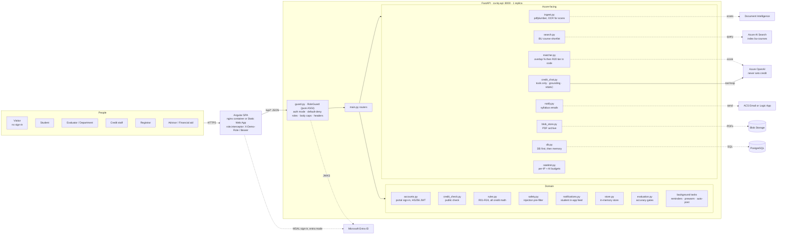
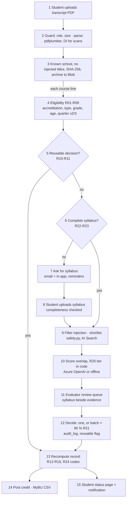

# Architecture (Architect agent)

**AI recommends, rules compute, evaluators decide.**

The rules engine does all credit math. The matcher only proposes a BU equivalent for courses nobody has decided yet. Credit changes only when a person records a decision. Every Azure service is optional (ADR 0003): unset its variable and an offline fallback takes over, which is how CI and the demo run.

## Components

Dashed = optional, with an offline fallback. The public chat is the only Azure call without one: without Azure OpenAI it says it is unavailable and points to the check form. Key Vault, Application Insights / Log Analytics and the Container Registry sit underneath; the API reaches Azure with managed identity and RBAC, no keys.

| Module | Responsibility | AI? |
| --- | --- | --- |
| `guard.py` | Runs before any route: auth mode, default-deny role matrix (mirrors `x-roles` in the contract), 10 MB upload / 64 KB public body caps, security headers. Students see only their own record. | No |
| `ingest.py` | Transcript PDF -> lines; syllabus completeness check. `%PDF-` magic, page limit, generic errors. | Document Intelligence for scanned PDFs only |
| `rules.py` | Eligibility, conversion, equivalency lookup, conflicts, duplicates, residency, 68-unit cap, deadline, codes | **No** (pure Python, unit-tested) |
| `matcher.py`, `search.py`, `safety.py` | Remove injected sentences, shortlist BU courses, score learning-outcome overlap, tier in code (R20), preliminary without a syllabus (R22) | Azure OpenAI + AI Search; offline fallback |
| Review (`main.py`) | Queue, single decision, batch (> 90 %, not preliminary, not flagged), reuse flag, own department only, audit | No |
| Status, `notify.py`, `notifications.py` | Plain-words status, syllabus request per transcript upload and reminders every `TRANSFERIQ_SYLLABUS_REMINDER_DAYS` (default 2), in-app feed, posting, MyBU CSV | No |
| `accounts.py` | Portal accounts (students, one per department, staff) and session JWTs | No |
| `credit_check.py`, `credit_chat.py`, `ratelimit.py` (ADR 0006) | No login: "will this course transfer?" form and chat. Per-course rules and reusable decisions only; preliminary estimate otherwise; rate limits and AI budgets; nothing stored | Chat chooses tools and words the reply; result cards come from the rules engine; reply checked against them (grounding); HMAC on assistant turns |
| `store.py`, `db.py`, `blob_store.py` | In-memory store loaded at start-up; every change written to PostgreSQL first; PDFs archived to Blob | No |
| `evaluation.py` | Scores the matcher on holdout decisions: top-1 >= 80 %, wrong credit <= 2 % (CI gate) | Measures it |

## One course, end to end

Without a complete syllabus the AI result is `preliminary` and `POST /decisions` answers 409 (R22). A decision that grants credit posts straight away; the registrar's `POST /postings` picks up any approved line left over.

## Sign-in modes

| `TRANSFERIQ_AUTH_MODE` | Caller proves identity with | Roles come from |
| --- | --- | --- |
| `demo` (default) | `X-Demo-Role` header chosen in the SPA | The header |
| `portal` | Per-user account, HS256 session JWT (`TRANSFERIQ_SESSION_SECRET`) | The account (`portal_accounts`) |
| `entra` | Entra access token (`Authorization: Bearer`) | The token's `roles` claim; `/docs` and `/openapi.json` are off |

Public without login: `/health`, `/auth/*`, `/credit-check*`, `/credit-chat`. Everything else follows the role matrix in `guard.py` (ADR 0005).

## Offline fallbacks (ADR 0003)

| Capability | Switched on by | Without it |
| --- | --- | --- |
| Course scoring | `AZURE_OPENAI_ENDPOINT` | Deterministic lexical overlap |
| Candidate shortlist | `AZURE_SEARCH_ENDPOINT` | Offline ranking (also on any search failure) |
| Search vectors | `AZURE_OPENAI_EMBEDDING_DEPLOYMENT` | Keyword + semantic only |
| Scanned PDFs | `AZURE_DI_ENDPOINT` | Text PDFs only |
| Persistence | `POSTGRES_HOST` | Seed CSVs in memory |
| PDF archive | `AZURE_STORAGE_BLOB_ENDPOINT` | Not archived |
| Email | `AZURE_COMMUNICATION_ENDPOINT` or `NOTIFY_WEBHOOK_URL` | Recorded as `not_sent`; in-app notification still shows |
| Public chat | `AZURE_OPENAI_ENDPOINT` | Unavailable; the check form still works |

## Deployment

Two ways to run the same two images (details in `infra/README.md`):
- **Containers only** (`scripts/deploy_aca.sh`, the demo path): nginx web container proxies `/api/*` to an internal API container.
- **Full platform** (`infra/main.bicep`, `deploy.yml`): Static Web App, API Container App, plus PostgreSQL, Azure OpenAI, AI Search, Document Intelligence, Blob, ACS, Key Vault and App Insights.

The API runs exactly one replica: writes go to PostgreSQL first, but reads come from the in-memory copy loaded at start-up. CI (`ci.yml`) runs backend tests and the quality gates offline, builds the SPA, compiles Bicep and checks that code changes come with an AI log.

See ADRs in `docs/adr/`, the data model in `docs/data-model.md` and the contract in `docs/api/openapi.yaml`.
