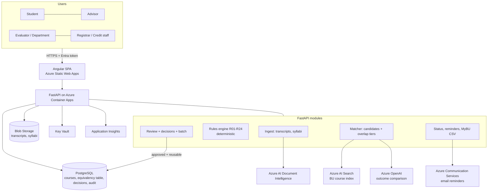

# Architecture (Architect agent)

**AI recommends, rules compute, evaluators decide.**

| Module | Responsibility | AI? |
| --- | --- | --- |
| Ingest | Parse transcript PDF -> lines; syllabus completeness check (outcomes, schedule) | Document Intelligence + LLM normalisation |
| Rules engine | Eligibility, conversion, existing equivalency, conflicts, duplicates, residency, 68-unit cap, status codes | **No** (pure Python, unit-tested) |
| Matcher | Narrow BU candidates (search), score learning-outcome overlap, tier, evidence, injection flag | Azure OpenAI; offline fallback for CI/demo |
| Review | Queue, single decision, batch (> 90%), reuse flag, audit | No |
| Status | Plain-words status, next step, secured vs pending, reminders day 7/21/45, MyBU CSV | Status wording only |

Data flow for one course: extract line -> rules (R01–R07) -> equivalency lookup (R10–R12) -> if none: syllabus state -> matcher -> evaluator -> decision saved (reusable) -> Department -> Registrar -> CSV.

See ADRs in `docs/adr/` and the contract in `docs/api/openapi.yaml`.
